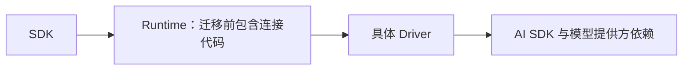
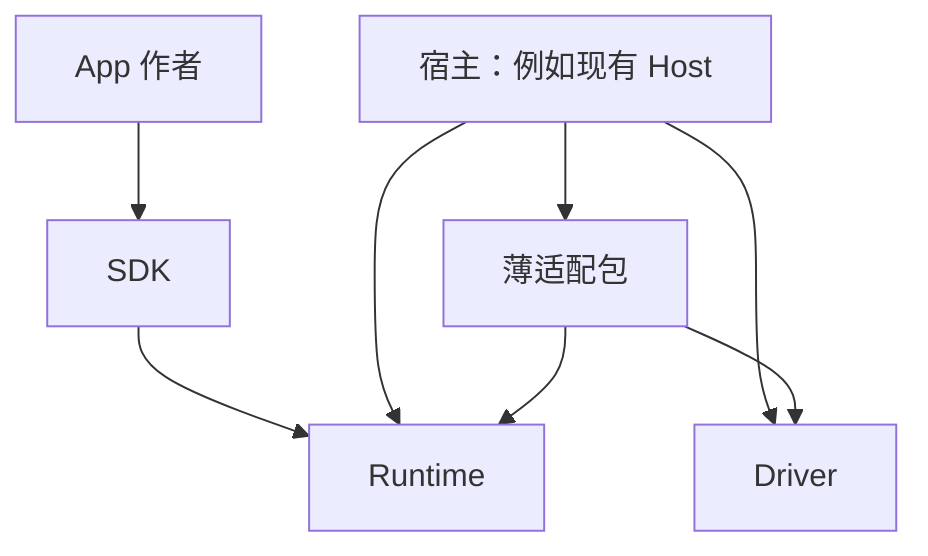

# Runtime 与 Driver 如何分开：已选方案 B、利弊与实施边界

2026-11-08 最新进度：SDK 四文件开发工具修复、四包正常 frozen 安装与构建、M4 原生身份采集及 Jest 合成诊断已分别独立限定 APPROVED。lint 恢复但保留原 3693 errors／110 warnings；IDE 原生 LSP 另行裁决。此进展不改变 B 包边界，也未解决 Driver 八条严格声明错误或批准完整集成、共享采用和发布。[本批精确裁决](MINIMAL_CORE_TS7_SDK_TOOLING_REVIEW_2026-11-08.zh-CN.md)。

2026-11-08 最新补充：TS7 新构建产品包的普通 TS／SDK Worker 各 22 次调用已由执行方与负责人在各自正常安装消费者中通过；独立重建四包 443 份 dist 一致，386 项 Core／CLI 通过。整体工具链仍为 CHANGES_REQUESTED。官方开发工具 API6 兼容方案仅有最小 lint 诊断的独立批准，下一批限 SDK 开发环境隔离实施与列明诊断，不改变 B 包边界，不解决 Driver 的 8 条严格 Tool 声明错误。[最新独立裁决与下一批](MINIMAL_CORE_TS7_REVIEW_2026-11-08.zh-CN.md)。

2026-11-08 补充：所有者已明确要求全链统一升级到最新稳定 TypeScript；负责人核对原始人类授权及官方版本为 7.0.2。B 的包边界决定保持，旧双版本诊断保留历史身份。新的多 Ref／可选 Ref 候选已通过独立 TS7 严格公共消费和双 Producer 真调用，但全链开发工具兼容及完整 Driver 上游类型问题仍未关闭。[原始授权](../review-evidence/typescript-unified-latest-20261108/owner-review/owner-authorization.json) · [版本核对](../review-evidence/typescript-unified-latest-20261108/owner-review/version-identity.json) · [最新限定交付与下一批准出](MINIMAL_CORE_SRT_02_MULTI_OPTIONAL_FINAL_REVIEW_2026-11-08.zh-CN.md)。

2026-11-07 更新。项目所有者已明确选择：“可以 那就长期推荐 B 吧”。负责人已在原始聊天核对该确认，SRT-06按B进入隔离实施；共享采用、发布和最终Semantic验收仍不包含在此次选择中。[选择依据与修改前文档](../review-evidence/srt-06-adapter-package-20261107/owner-review/owner-selection.json)保留原件。下文继续保留A／B／C比较，作为决策理由，不再把B记为尚未选定。

**本日最新实施结果：B 的 r02 隔离迁移及 Runtime／SDK 独立包消费已获独立 APPROVED；完整集成类型准出仍为 CHANGES_REQUESTED。** 两组正常安装及 Runtime 双版本严格类型、真实 Worker、适配包 Ref 调用与正常关闭均已有独立复验。正常发布依赖图在 TS5.3.3／5.9.3 下仍有 51／8 条错误，同图 Driver-only 逐字复现。候选为`.tmp/srt-06-adapter-package-20261107/source-r02`，本说明中的职责图描述已实现于隔离候选的边界，不能当成共享工作树已采用。[B 精确裁决](MINIMAL_CORE_SRT_06_ADAPTER_REVIEW_2026-11-07.zh-CN.md)。

后续三组依赖诊断与一个单点声明副本实验已独立签收：在新的 zod3 精确图中，补一处第三方声明能消除 TS5.9.3 的严格工具错误；TS5.3.3 的语言能力问题仍存在。它只证明根因，当时没有修复正常发布包或改变支持政策。编译器政策随后已按上文所有者新决定更新；正式依赖分发与严格集成仍须解决，B 的包边界决定保持。[诊断与限定实验的独立结论](MINIMAL_CORE_SRT_06_DECLARATION_PROBE_REVIEW_2026-11-07.zh-CN.md)。

**已确定采用B：用一个很薄的独立适配包，承接现有的连接代码，让 Runtime 和 Driver 各自保持独立，并继续向第三方宿主提供现成连接入口。**

Host内部模块是此前比较过的可行方案：若只服务官方Host，它有较低的维护成本。本次选择B，接受一个额外发布单元的成本，以保留Runtime、Driver各自独立和连接器公共分发。Host仍负责组装使用这些包。

我前一版推荐把连接代码放进现有 Driver 包，主要考虑少增加一个包。这个方案技术上可行，但会把安装依赖从“Runtime 带上 Driver”反转成“Driver 带上 Runtime”。重新按本项目的长期基础设施目标权衡，我更倾向独立适配包。它有明确的额外维护成本，下面把这笔账讲清楚。

## 1. 先把这几个角色讲清楚

| 名称 | 用人话说，它负责什么 |
| --- | --- |
| SDK | 帮 App 作者声明页面、工具和 Ref。作者在这里表达自己的业务。 |
| Runtime | 维护应用的当前页面、观察和引用；检查调用来源、身份与参数；管理运行和关闭。 |
| Driver | 把各个来源的消息和工具交给模型，再把模型的工具调用交给本轮捕获的执行入口。 |
| 本文所说的“适配器” | 把 Runtime 的页面、工具和操作收据，转换成这个 Driver 理解的上下文，并维护这次上下文持有的观察。现有类名是 `SemanticAOTUIDrivenSource`。 |

适配器已经存在。本次将其迁入独立包，由新包对外提供。App 的工具声明、Ref 数据发布，以及 Runtime 的授权和释放机制，都有现成实现，不需要再设计一套。

## 2. 当前的问题到底是什么

迁移前已封存的Group A候选中，适配器在Runtime包里；Runtime的`package.json`也直接依赖Driver。因此，安装完整Runtime包会把具体Driver及其依赖图带进来，即使使用者打算自己连接另一种Agent系统。



图中的箭头表示包依赖，不表示每次导入都会执行所有代码。前一轮 r05 的 Core／SDK 类型样本能在 TS 5.3.3 下通过；含 Driver 的适配入口遇到了 36 条依赖声明错误。这两件事可以同时成立，不能说整个内核都运行失败。

2026-11-07 补充实测：本轮旧工具退出候选开启完整的 `exactOptionalPropertyTypes:true`，移除此前精确声明路径映射后，适配入口在 TS 5.3.3 下报告42条、TS 5.9.3 下报告10条错误，均位于 Driver 的第三方声明依赖；包括原有编译器兼容问题、可选属性约束，以及本地依赖装配中的两条 `json-schema` 声明解析失败。Core／SDK 的普通公共类型子集仍通过两版编译。这次是实际 tar 加本地第三方依赖的诊断消费者，正常包管理器离线安装未成功，不能据此断言正式安装也有完全相同的解析问题。[本轮原始结果](../review-evidence/srt-02-retirement-candidate-20261107/public/attempt-01/result.json)

负责人随后只导入冻结Driver的类型、完全不引入Runtime／SDK，独立复现了逐条相同的42／10条诊断。因此，本批内核清理没有引入这组错误；兼容门禁仍需单独通过。[独立对照](../review-evidence/srt-02-retirement-candidate-20261107/owner-review/driver-strict-control/comparison.json)

这里有两个不同的问题：

1. **职责与依赖位置不合理。** 通用内核不应该为了提供某一种 Driver 的连接方式，要求所有消费者安装它。
2. **Driver 自身的类型兼容没有过完整门禁。** 改变代码位置不会消除依赖声明错误，仍须按完整编译选项和正常安装结果单独处理。

本方案先把第一件事处理正确，同时保留第二件事的失败记录和验收责任。

## 3. 有哪些选择

| 方案 | 好处 | 代价与限制 | 我的判断 |
| --- | --- | --- | --- |
| 继续放在 Runtime | 当前改动最少 | 具体 Driver 继续进入 Runtime 的安装图；不满足已确认的去依赖方向 | 不作为目标方案 |
| **C：放进 Host 内部模块** | 不新增包；官方Host直接使用；Runtime和Driver都可以保持独立 | 旧Source的第三方公共分发没有现成替代入口，需要明确接受支持范围变化；不能把Host私有路径当公开包 | 官方Host为当前唯一交付目标时，是更简的可行方案 |
| **A：放进现有 Driver 包** | 不增加包；迁移位置和版本管理较少；Runtime 可以独立安装 | Driver 从此要安装 Runtime；Driver 的独立使用者也承担这部分成本；新增 exports map 还需处理既有深路径的影响 | 短期成本较低，长期取决于 Driver 的产品定位 |
| **B：独立薄适配包** | Runtime 与 Driver 都保持独立；只有需要连接两者的宿主才使用适配包；责任和兼容关系更清楚 | 多维护一个包、一套导出和匹配版本；宿主集成多一个依赖和导入入口 | **已选择，r02 限定隔离迁移通过；完整集成类型仍阻断** |

方案 A 不会因为新增依赖就自动启动 Runtime。它增加的是安装关系和维护关系，实际加载仍可以通过独立子入口隔离。这是它真实的优点，也说明我们不应夸大它的坏处。

方案 B 也不会自动带来稳定性。它需要正式包消费者测试、明确的版本配对和持续维护；只把文件搬到新目录，不能算完成。

**代码可以放在Host，但要分清三种做法。**

| “放在Host”的具体含义 | 实际效果 |
| --- | --- |
| `host/src/adapters/` 下的普通内部模块 | 就是方案C。只依赖注入的Runtime对象和公开Core／SPI能力，模块本身无需引入Electron、GUI或数据库初始化。现有Host已经依赖Runtime和Driver，归属自然。 |
| 仍属于整个Host包，另导出 `@aotui/system-chat/aotui` | 可以隔离这一入口的代码加载，但安装整个Host的依赖成本仍在。不能把“没有启动Electron”说成“没有安装Host依赖”。 |
| 源码放在Host目录下，但有自己的package.json、构建和发布产物 | 本质上仍是方案B的独立适配包。代码目录位置可以如此安排，分发边界并没有变。 |

当前具名生产消费者集中在Host；限定搜索不能证明不存在仓库外消费者。选择C时，应明确记录旧公开Source入口退出，并把验收调整为“Runtime公共包消费＋Host内实际集成”，而非假装仍有一个可单独安装的公共Source包。Runtime自身的通用能力仍可供其他宿主使用，但它们不再从原入口获得这份现成连接器。

## 4. 选择方案 B 的长期理由

**它同时保留两边已经有的独立性。** Runtime 面向不同 Agent 系统；当前 Driver 的核心代码也没有依赖 Runtime，能够聚合不同来源。没有明确产品要求时，不宜把“使用 Driver 必须安装 Runtime”新增为固定条件。

**它把兼容责任放在实际连接两边的地方。** Runtime 维护自己的交互合同，Driver 维护模型与执行合同，适配包验证二者的组合。某一边升级时，连接是否仍成立有明确的检查位置，问题不会因为包名改变而被掩盖。

**这次增加包有现实依据。** 现有 Source 已经是公开能力，既有 Host 在使用，公共消费者测试也在验证。它本来就同时理解 Runtime 和 Driver。把这个现有职责单独分发，是清楚划分代码归属；无需预先设计插件系统、通用协议包或新的注册框架。

**App 作者不承担新增接线职责。** 开发 App 仍使用 SDK，声明工具、页面和 Ref 的方式不因本次分包增加步骤。需要多了解一个适配包的是搭建宿主、连接模型的开发者。这是实际增加的认知成本，应明确承认。

方案A适合把Driver作为Runtime固定配套产品；方案C适合只保留官方Host中的连接器。此次选择B，保留既有Source的公共分发方向，同时避免增加Runtime与Driver之间的直接包依赖。这个选择不扩展为SDK／Runtime的全面多包拆分。

## 5. 已选方案具体长什么样

隔离实施使用 **`@aotui/agent-driver-adapter`** 作为目标包名，尚未发布。目标依赖关系如下：



图中 Runtime 和 Driver 之间没有直接依赖。适配包明确声明自己需要兼容的两者，宿主负责选择配套版本；已有 Host 本来就使用 Runtime 和 Driver。

对使用 Source 的宿主，主要代码变化是导入位置：

```ts
// 当前入口
import { SemanticAOTUIDrivenSource } from '@aotui/runtime/adapters';

// 此前备选 A：放入现有 Driver 包，本次未采用
import { SemanticAOTUIDrivenSource } from '@aotui/agent-driver-v2/aotui';

// 已选方案 B 的目标入口；实际产物仍需独立验证
import { SemanticAOTUIDrivenSource } from '@aotui/agent-driver-adapter';
```

类名、构造方式、`getContext()`、本轮工具执行和 Context 释放合同保持。旧 Runtime Source 出口在正式迁移时退出，不保留一个暗中重新引入 Driver 的转发出口。

方案 B 的具体文件归属如下：

| 现有职责 | 迁移后的归属 |
| --- | --- |
| `SemanticAOTUIDrivenSource`、receipt→ToolResult 转换、Driver 工具和消息构造 | 从 Runtime 迁入薄适配包，保留原算法与完整类型 |
| Source 专用的状态／时间显示格式化，以及指令加载函数 | 随 Source 迁移，保留现有格式、读取优先级与失败行为 |
| 默认系统指令正文和既有公开常量 | 留在 Runtime，现有 Host 的默认指令导入保持 |
| 工具名校验与 View 包装的现有纯函数 | 保留同一份实现，通过明确的中立入口复用；不复制两套规则 |
| Snapshot、Observation、Scope、Ref 解析、参数编译、授权、调用记录与释放 | 留在 Runtime；SDK 继续复用原参数编译器 |
| 模型调用、工具派发、停止门禁、Driver Context 类型 | 留在 Driver，不因搬适配器而重写 |
| App 的业务 ID、业务状态和权限判断 | 仍由 App 自己负责；文件路径继续直接使用，不增加 Ref 包装 |

工具名函数不能整体搬出 Runtime，因为 AppKernel 自己也在使用。与现有方案 A 相同，这里仍需明确公开最少的共享函数。包分开并不意味着可以复制校验、暴露私有 Receiver 或把资源责任交给 App。

薄适配包的公开面应只包含现有 Source 和 Options 等必要入口。包内不新增第二个执行器，不拥有独立业务状态，不提供通用插件管理，不为“将来可能有别的 Driver”先做注册体系。

安装关系建议使用**明确必需的 peer 依赖**描述 Runtime／Driver，由宿主选定兼容组合；开发和验证使用精确匹配的产物。这里的 peer 只描述安装关系，不能代替真实兼容测试或已有协议校验。它也不同于把 Source 继续留在 Runtime、仅把 Driver 标成 optional peer：后者没有完成职责迁出。

## 6. 它要付出的维护成本

方案 B 多一个发布单元，因此必须承担：包 manifest 和导出维护、自己的构建产物、对两个依赖版本的配对说明、正常安装测试，以及迁移文档。宿主也要显式安装它。这些成本不会因为实现很薄就消失。

可以把成本限制在一个固定边界：只新增这一个已有连接职责的包，复用现有 TypeScript 构建和测试方法；不另建发布平台，不拆出公共协议包，不扩大到 SDK／Runtime 的全面多包重组。

与方案 A 相比，方案 B 还减少两项影响：Driver 不必新增 Runtime 安装依赖，也不必为了这次迁移新增 `./aotui` exports map。因此，现有 Driver 根入口及其深路径政策可以保持本次改动前的状态。

实现直接沿已选B迁移一次。此前A的技术提案保留为历史，不先落地A再改成B，避免宿主导入和配套文档重复迁移。

## 7. 如何推进和验收

旧 Snapshot Tool 清理和这次分包是两个有区别的改动：前者删除重复声明、注册和执行路径；后者整理剩余连接代码的归属。因为它们会修改同一个 Source，实施由一个执行者按顺序完成：

1. 已完成的旧工具清理作为冻结基线：源码清单`bd6e3272…`、累计patch `7bf92c2e…`。保留该组原件及独立裁决。
2. 在新的隔离候选中，从清理后的Source迁出适配职责，同步宿主导入、公共消费者、保留测试与当前文档。两组改动分开审阅，最终集中验证。
3. 构建正式形态的包，在全新消费者中正常安装，验证实际依赖、类型和运行行为。白名单内的小修用 attempt 记录，不为每个小问题重新写一整套范围报告。

SRT Owner独占生产实现与消费者迁移；当前签收候选为`.tmp/srt-06-adapter-package-20261107/source-r02`，r01的`source`另行冻结保留。Minimal Core负责本说明、当前进度和独立代码／测试复核，不并发修改该生产候选。B的独立结论基于它自己的精确patch和运行证据。

验收必须回答两个问题：

| 检查 | 要证明的事实 |
| --- | --- |
| **内核独立消费** | 不安装具体 Driver 或适配包，仍能从正式 Runtime／SDK 入口消费约定能力；安装图与声明不偷偷引回 Driver。 |
| **完整连接消费** | 安装配套 Runtime、Driver、适配包后，页面、工具、Ref 来源、短收据、单次执行、最新 View 和真实关闭保持正确。 |

两项保留既有公共类型要求：TS5.3.3／5.9.3、strict、exactOptionalPropertyTypes、skipLibCheck:false，以及真实tar全新安装。此前r05或Group A的限定批准不能替代迁移后的完整门禁，也不授权提高TypeScript支持下限。

**Driver 的类型错误不会因搬移 Source 自动消失。** 原 r05 的36条和本轮完整选项下的42／10条分别保留；内核独立消费可以单独完成验证，连接消费若仍失败，就继续记录为失败。依赖修复或编译器支持政策需要另作有依据的决定，不能以分包通过冲抵它。

所有者选择B不构成新包安装或迁移后行为已经通过的证据。此前“2–4个有效工程日”只是对方案A后续部分的粗估，不能套用为整个项目工期，也不能直接作为方案B的承诺。

## 8. 当前决定与批准边界

前一份技术复核的APPROVED，表示方案A的边界和实施提案技术上成立。现在所有者已选择B，B仍须按其独立分发边界完成验证，不能直接套用A的签收。

此次实施只搬迁已有连接职责，并处理必要导出、依赖、构建、调用方和当前文档。Driver执行主链、Core／Ref算法与App作者接口保持原有职责；兼容修复需要具体范围及验证依据，不能借搬迁放宽准出标准。

原先看文档、询问Host和催进均未被当作分包批准；这次原始用户消息才明确选定B。B 的 r02 代码补丁、实际包和验证结果已形成独立限定批准，下一份交付是保留既有严格门禁的 Driver 类型兼容修复方案。共享采用、推送、合并、发布及最终Semantic验收仍另按既有权限执行。

代码事实与已有裁决可在这些文件核对：

- [当前 Source 及其直接依赖](../.tmp/srt-02-consumer-migration-r05-20261107/source/runtime/src/adapters/semantic-aotui-driven-source.ts)
- [候选 Runtime 的包依赖](../.tmp/srt-02-consumer-migration-r05-20261107/source/runtime/package.json)、[当前 Driver 包](../agent-driver-v2/package.json)、[Driver 的上下文合同](../agent-driver-v2/src/core/interfaces.ts)
- [方案 A 的具体文件清单和技术提案](MINIMAL_CORE_SRT_06_RELOCATION_PROPOSAL_2026-11-07.zh-CN.md)、[独立技术复核](MINIMAL_CORE_SRT_06_RELOCATION_REVIEW_2026-11-07.zh-CN.md)
- [类型兼容事实与完整门禁](MINIMAL_CORE_CONSUMER_TYPE_COMPAT_REVIEW_2026-11-07.zh-CN.md)、[旧工具退出范围](MINIMAL_CORE_SRT_02_RETIREMENT_SCOPE_REVIEW_R02_2026-11-07.zh-CN.md)
