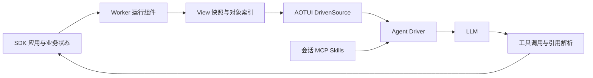

# AOTUI 项目价值与框架发展判断

评估日期：2026 年 10 月 7 日。代码基线：`789ef07` 的当前工作树。产品方向已确认：优先服务开发 Agent 应用和平台的开发者，以 Runtime 和 SDK 为核心。

**AOTUI 最值得发展的产品，是一套让开发者构建有状态 Agent 应用的交互运行时。** 开发者声明当前有哪些对象、对象处于什么状态、允许哪些动作；框架负责把这些声明组织成模型可读、程序可执行、可持续更新的工作环境。Agentina 桌面端和现有应用为这套能力提供验证场景。

当前已经形成可运行的技术原型，具备值得继续投入的编程模型和分层。下一阶段的决定性工作，是兑现对象身份、状态新鲜度和执行结果的契约，并用可重复实验说明采用它的收益。现阶段不能把更低成本、更高任务成功率或成熟生态当作已经证明的事实。

**开发者真正需要买单的问题，是多步任务中的状态协调成本。** 一个面向业务的 Agent 往往同时处理文件、检索结果、后台任务和外部系统记录。应用开发者不得不反复实现状态读取、结果去重、对象选择、动作可用性、异步更新、上下文裁剪与错误恢复。AOTUI 可以把其中稳定的交互机制收进框架，让应用保留业务状态和业务规则。

例如，开发者接入一个工单系统时，除了暴露查询和更新函数，还要处理：工单列表如何保持最新、同名工单如何区分、用户刚改过的工单能否继续执行旧动作、处理完成的工单如何退出上下文。AOTUI 的价值假设是，让这些问题有统一的编程入口和运行时保证。

适合优先服务的开发者有两类：

| 开发者 | 需要解决的问题 | AOTUI 应交付的价值 |
| --- | --- | --- |
| Agent 应用作者 | 把已有业务对象组织为可持续操作的工作环境 | 熟悉的组件与状态模型，统一的视图、引用、动作、错误处理 |
| Agent 平台作者 | 将多个应用接入自己的模型循环与上下文系统 | 可独立嵌入的 Runtime，清晰的状态与工具输出，宿主可控制的生命周期和策略 |

第一类用户证明 SDK 是否好用，第二类用户证明框架是否真正独立于 Agentina。纯计算函数、一次查询即可完成的工具，通常没有足够的状态协调需求来抵消引入完整应用运行时的成本。

**核心执行链已经落在代码里。** 应用用 Preact 组件声明视图，Worker 运行组件并把变化转换为快照，Runtime 聚合快照和对象索引，Driver 把当前状态与会话一起交给模型，再将工具调用路由回应用。

这里的“更新上下文”发生在下一轮模型请求的输入组装阶段。运行时保留当前视图投影，并据此重新构造请求；它没有修改模型已经处理过的历史请求或 KV Cache。业务系统仍然是业务事实的来源，视图是受维护的、有范围的工作投影。

| 模块 | 当前职责 | 对框架产品的意义 |
| --- | --- | --- |
| `sdk` | `createTUIApp`、`View`、引用、工具注册、状态与持久化 Hook | 开发者直接接触的产品面 |
| `runtime` | 应用生命周期、Worker、快照、索引、锁、操作路由 | 核心语义契约的执行者 |
| `agent-driver-v2` | 多来源上下文组装、模型调用、工具执行、信号调度 | 当前参考 Agent 循环与集成入口 |
| `host` | Electron GUI、会话、配置、消息存储、MCP、Skills、IM 装配 | 框架的真实使用者和调试环境 |
| `demo-apps` | IDE、终端、网页检索、规划、Token 监控 | 用真实行为验证抽象是否成立 |

入口可从 [createTUIApp](/Users/zhangwei/JSWorkSpace/learning_code/AgentOrientedTUI/sdk/src/app-factory/createTUIApp.ts:124)、[createRuntime](/Users/zhangwei/JSWorkSpace/learning_code/AgentOrientedTUI/runtime/src/facades/facades.ts:61)、[Kernel.acquireSnapshot](/Users/zhangwei/JSWorkSpace/learning_code/AgentOrientedTUI/runtime/src/kernel/index.ts:171) 和 [宿主装配](/Users/zhangwei/JSWorkSpace/learning_code/AgentOrientedTUI/host/src/core/session-manager-v3.ts:458) 理解。

**已有设计中，四项资产值得保留并加强。**

1. **把业务状态和可执行动作放在同一个交互模型中。** `View` 负责呈现，引用负责绑定对象，Tool 负责动作。Lite Browser 已经通过组件挂载和 `enabled` 控制有结果时才注册结果操作、有页面时才提供关闭操作。这减少了应用作者分别维护展示文字和工具集合的重复劳动，但动作执行时仍需要重新校验前置条件。[应用实例](/Users/zhangwei/JSWorkSpace/learning_code/AgentOrientedTUI/demo-apps/lite-browser-app/src/tui/RootView.tsx)

2. **把当前工作状态与历史记录分开。** 上下文组装已有静态说明、会话历史、动态视图和当前执行尾部四段，并尝试保持工具调用与结果配对。这为管理当前工作集提供了基础；会话仍需要压缩，视图仍需要预算，不能据此声称上下文不再增长。[上下文组装](/Users/zhangwei/JSWorkSpace/learning_code/AgentOrientedTUI/agent-driver-v2/src/core/context-regions.ts:130)

3. **按视图类型复用工具定义。** 多个同类型视图可以共享一套工具，调用时选择目标实例，避免每打开一个文件就重复暴露整套工具。这个方向有助于控制工具数量；目标实例与引用必须被严格绑定，才能发挥价值。[工具 API](/Users/zhangwei/JSWorkSpace/learning_code/AgentOrientedTUI/sdk/src/hooks/useViewTypeTool.ts:86)

4. **用统一来源接口接入不同能力。** `IDrivenSource` 将消息、工具、执行和更新通知放在同一个边界，宿主已将 AOTUI、会话、MCP 和 Skills 装配在一起。这为接入其他 Agent 平台提供了基础。当前接口仍把消息和工具分开读取，观测一致性需要进一步收紧。[来源契约](/Users/zhangwei/JSWorkSpace/learning_code/AgentOrientedTUI/agent-driver-v2/src/core/interfaces.ts:83)

**项目定位需要建立在能兑现的契约上。** MCP 已经定义资源订阅和工具列表变化通知；MCP Apps 也提供交互式界面与模型上下文更新机制。因而，“现有协议只能追加结果、完全没有状态能力”不足以支撑项目定位。[MCP 资源规范](https://modelcontextprotocol.io/specification/2025-11-25/server/resources)、[工具规范](https://modelcontextprotocol.io/specification/2025-11-25/server/tools)、[MCP Apps](https://apps.extensions.modelcontextprotocol.io/api/documents/Overview.html)

更可检验的定位是：**AOTUI 为 Agent 应用提供统一的状态、对象身份和动作生命周期，并让开发者用一套声明式接口实现它们。** MCP 等协议可以承担连接与传输，AOTUI 负责应用内部的交互语义和运行时行为。当前宿主同时接入两者，也支持这种协作关系。

历史[商业计划](/Users/zhangwei/JSWorkSpace/learning_code/AgentOrientedTUI/docs/business-plan.md)中的“基础设施已经完成”“接口只能追加历史快照”等表述，需要在后续更新时收紧。当前 README 已更准确地把问题限定为一种缺少当前状态维护的执行模式，也明确标注项目仍处于实验阶段。对外叙事应以这套更谨慎的表述为基础。

**最优先的工程问题，是几个核心承诺尚未得到完整保证。** 这些问题会直接影响开发者是否敢于把业务动作交给框架。

| 发现 | 证据强度 | 影响与处理方向 |
| --- | --- | --- |
| 业务失败被外层成功结果包装 | 已通过真实 AppKernel 的小范围调用复现 | SDK 处理器返回 `success: false` 后，AppKernel 返回外层 `success: true`。嵌套错误仍在数据中，但适配器与 Driver 的顶层错误统计会走成功分支。统一返回契约，保留业务错误语义 |
| 同类型视图的同名引用可能解析到错误实例 | 已通过两个视图的调用复现 | 指定第二个视图后，解析仍按该类型的视图顺序寻找引用，可能命中第一个视图。先限定目标视图，再解析引用；跨视图引用需要显式的完整身份 |
| 列表位置引用会随重排改变目标 | 重绑定行为已复现，旧观测被误用的完整异步流程尚未做端到端验证 | `items[0]` 表示当前位置，不能单独承担跨更新的稳定对象身份。引入对象稳定键或带版本的快照句柄 |
| 读取状态与执行动作之间缺少完整版本校验 | 执行链源码显示的设计缺口 | 消息、工具和执行分别获取快照，执行使用新快照；快照 ID 与租期尚不能证明动作基于模型看到的同一版本。应明确过期观测如何拒绝、刷新或重试 |

失败包装位于 [AppKernel.callTypeTool](/Users/zhangwei/JSWorkSpace/learning_code/AgentOrientedTUI/runtime/src/worker-runtime/app-kernel/AppKernel.ts:657)。视图作用域问题位于 [引用参数解析](/Users/zhangwei/JSWorkSpace/learning_code/AgentOrientedTUI/runtime/src/worker-runtime/app-kernel/AppKernel.ts:695)及[引用查找](/Users/zhangwei/JSWorkSpace/learning_code/AgentOrientedTUI/runtime/src/worker-runtime/app-kernel/AppKernel.ts:778)。位置引用来自 [useArrayRef](/Users/zhangwei/JSWorkSpace/learning_code/AgentOrientedTUI/sdk/src/hooks/useArrayRef.ts:96)，执行时重新获取快照见 [AOTUIDrivenSource](/Users/zhangwei/JSWorkSpace/learning_code/AgentOrientedTUI/runtime/src/adapters/aotui-driven-source.ts:487)。

小范围复现得到的结果分别为：`{ success: true, data: { success: false, ... } }`；请求 `results_b` 中的 `results[0]` 却取得 `results_a` 的对象；重绑定同一个位置引用后，调用取得新对象。诊断采用实际 AppKernel、轻量组件工厂和 LinkeDOM，未调用模型，也未经过完整 Worker IPC 链，因此不能将结果扩大为所有应用流程的端到端结论。

**运行时还需要明确“当前”的边界。** IDE 的文件视图会订阅应用内的 `file_changed` 事件，应用自己的写文件操作也会发送该事件。沿已检查的这条链路，没有看到将任意外部文件变化统一转为刷新和冲突检查的机制。刷新能力应由数据源适配器负责，Runtime 则负责传播失效与版本；桌面内存锁无法阻止外部编辑器或另一台机器修改同一份业务数据。[文件视图刷新](/Users/zhangwei/JSWorkSpace/learning_code/AgentOrientedTUI/demo-apps/aotui-ide/src/tui/FileDetailContent.tsx:193)、[写入后的事件](/Users/zhangwei/JSWorkSpace/learning_code/AgentOrientedTUI/demo-apps/aotui-ide/src/tui/RootView.tsx:945)

同样，当前 Worker 机制提供独立的执行上下文与 DOM 环境。应用可以调用 Node 能力，发布材料应准确说明隔离范围；不可信代码的权限约束需要单独设计。这个边界与面向 Agent 的语义视图是两项不同职责。[Worker 创建](/Users/zhangwei/JSWorkSpace/learning_code/AgentOrientedTUI/runtime/src/engine/app/worker-host.ts:141)

**成本价值需要测量，而且测量链路本身要先校准。** 当前 `llm-client` 从 AI SDK 的 usage 中读取 `promptTokens` 和 `completionTokens`；本地安装版本的类型定义使用 `inputTokens` 和 `outputTokens`。按这一类型契约返回的 usage 会使前两个计数回退到零。该映射还没有保留缓存读写明细，不能直接用于完整成本比较。[usage 映射](/Users/zhangwei/JSWorkSpace/learning_code/AgentOrientedTUI/agent-driver-v2/src/core/llm-client.ts:321)

动态替换视图可能减少冗余状态，也可能改变缓存前缀。工具集合变化同样会影响前缀复用。现有上下文分层为优化提供了起点，但是否更便宜、更快，仍要结合实际模型、缓存命中和任务轮数判断。[OpenAI Prompt Caching 机制](https://developers.openai.com/api/docs/guides/prompt-caching)

**开发者体验的主要缺口，在于从“作者自己能用”到“外部开发者能独立接入”。** 当前根 workspace 只配置了 `packages/*`，核心包通过脚本逐个安装、构建和链接。SDK 测试中还有一项指向已有 `dist` 的别名，部分公开注释示例仍引用已不再导出的旧 API。这些现象说明，需要建立干净安装、最小示例和发布包验证，才能把本地成功转为可重复的外部成功。[workspace](/Users/zhangwei/JSWorkSpace/learning_code/AgentOrientedTUI/pnpm-workspace.yaml:1)、[开发安装脚本](/Users/zhangwei/JSWorkSpace/learning_code/AgentOrientedTUI/setup.sh)、[测试别名](/Users/zhangwei/JSWorkSpace/learning_code/AgentOrientedTUI/sdk/vitest.config.ts:13)、[旧 API 示例](/Users/zhangwei/JSWorkSpace/learning_code/AgentOrientedTUI/sdk/src/index.ts:194)

**本次验证建立了可继续工作的工程基线。**

| 验证范围 | 结果 |
| --- | --- |
| Runtime 全套现有 Vitest | 44 个测试文件通过；380 项通过、3 项跳过、7 项待实现 |
| SDK 全套现有 Vitest | 7 个测试文件通过；64 项通过 |
| Agent Driver 全套现有 Vitest | 3 个测试文件通过；19 项通过、1 项跳过 |
| Host 的来源控制、MCP 来源、会话来源与压缩集成测试 | 4 个测试文件通过；19 项通过 |
| Runtime、SDK、Agent Driver 的 `tsc --noEmit` | 全部通过 |
| AppKernel 定向诊断 | 复现失败包装、引用实例选择和位置重绑定行为 |

现有测试共执行通过 482 项，另有 4 项跳过、7 项待实现；定向诊断不计入这个数字。这是基于当前已安装依赖及已有构建产物的本地验证。Electron GUI、所有 Host 测试、干净发布安装以及真实模型的任务效果不在这组结果的证明范围内。本次没有测量测试覆盖率。

**推荐路线是 Runtime 和 SDK 优先，Agentina 作为参考宿主。** 按已经确认的目标用户，三种投入方式的取舍如下。

| 路线 | 收益 | 代价 | 适用判断 |
| --- | --- | --- | --- |
| Runtime 与 SDK 产品化，保留参考宿主 | 直接服务目标开发者，可以把可靠性、接入效率和可迁移性积累为长期能力 | 需要持续处理一致性、调试和兼容性，演示效果不一定立刻更丰富 | 当前推荐 |
| 优先输出轻量协议与适配层 | 容易接入已有 Agent 平台，整体集成范围较小 | 对宿主上下文和执行链控制有限，必须明确由谁兑现状态契约 | 在第二个宿主需求明确后逐步提炼 |
| 优先扩展完整桌面产品 | 易于提供完整体验，便于自身使用和展示应用价值 | GUI、渠道和配置功能会持续占用核心框架投入，未必促进外部开发者采用 | 用真实框架需求约束其投入范围 |

长期可积累的优势包括：清晰且稳定的语义契约、可复现的故障恢复、开发调试工具、跨宿主适配经验、代表性任务基准，以及确实复用框架的外部应用。文本标记格式和 Preact 写法本身容易被复现，需要通过这些工程资产转化为采用价值。

**后续工作应按验证门槛推进。** 下面是建议的顺序与完成标准，不是已经实施的改造。

1. **先写最小契约，再修复执行链。** 用一页可执行示例定义 View、Ref、Tool、Snapshot 的关系，说明引用作用域、版本、关闭后的失效、业务错误与传输错误。先覆盖已经复现的问题，再补多实例、重排、外部变化和旧调用场景。完成标准：旧引用不会静默作用于另一个对象；业务失败能传到顶层并触发正确恢复。

2. **建立一条独立的开发者路径。** 使用现有包提供无需 Electron 的最小应用、运行和调试示例，验证打包后的 SDK 与 Runtime。保持底层读取和动作执行可由宿主调用，逐步明确默认 Driver 与可替换宿主之间的边界。完成标准：不了解内部类的开发者可以从干净环境运行示例、加入一个动作，并看懂一次错误。

3. **用代表性任务证明收益。** 优先复用 IDE 和终端验证文件变化与长任务，增加一个小型对象列表场景验证重排和并发。至少比较普通工具历史、经过合理去重与压缩的工具方案、AOTUI 三组；共用同一业务后端、模型设置、任务和扰动，重复运行。完成标准：能够解释成功率、错误对象操作、恢复轮数、真实计费输入和端到端延迟的差异，并列出 AOTUI 不占优的场景。

4. **以第二个宿主和外部应用检验通用性。** 让一个已有 Agent 循环接入同一个应用，允许适配宿主但避免重写业务逻辑。邀请外部开发者实现一个具体小场景，记录接入时间、必须阅读的内部文件和需要逃离默认行为的位置。完成标准：框架抽象得到实际复用，而不是只在自身桌面产品里成立。

基准测试需要先修正 usage 字段，再区分未缓存输入、缓存输入、输出、模型调用次数和工具耗时。任务成功应由业务后置条件判定，例如最终文件内容或目标对象状态，避免依赖模型自己声称“已完成”。

**关键技术选择也应保留明确取舍。**

| 选择 | 推荐起点 | 原因与代价 |
| --- | --- | --- |
| 对象引用 | 视图作用域内的稳定对象键，配合显式版本；保留可扩展到跨视图身份的空间 | 比位置下标更可靠；需要开发者提供对象身份和失效规则 |
| 观测到执行的一致性 | 一次观测共同提供状态、工具和版本；变更动作按契约检查版本，必要时使用底层系统的条件写入 | 能识别基于旧状态的动作；会增加刷新或冲突恢复轮数 |
| 上下文组织 | 继续使用分层的当前视图，加有界的执行历史；先做视图选择和预算，再用实验决定是否引入 delta | 当前状态容易理解和调试；每轮仍有重发成本。纯 delta 更省传输的潜力需要与重放和模型重建成本一起验证 |
| SDK 暴露层次 | 最小应用入口、常用配置、底层生命周期与宿主适配依次开放 | 默认路径保持简单，复杂场景有扩展出口；需要维护清晰的公共 API 和兼容承诺 |

项目下一阶段最有说服力的成果，是一个外部开发者能够独立构建、接入和调试的状态化应用，以及它在明确任务上带来的可重复收益。这能同时回答开发者的三个问题：为什么需要它、怎样开始使用、复杂场景下能否信任它。
