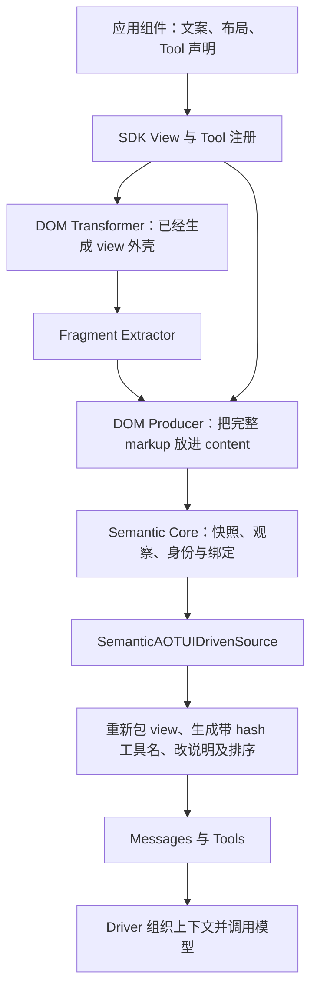

# Semantic 接入后 Messages / Tools 变化的根因审计

> 本文保留修复前的根因审计与当时的定位。源码现已修复，当前状态、实际验证与生效方式见 [修复交付](REPAIR-RESULT.zh-CN.md)；原缺陷探针和失败日志保留作历史证据。

日期：2026-10-29，Asia/Shanghai。检查对象：当前工作树，HEAD `194daa53e82b792aa460243e454c1d58caf57e5a`，以及项目所有者提供的新旧两份日志。

本次只调查根因，新增此审计目录；没有修改生产实现、重建共享 dist、操作真实 IDE 工作区或联系旧 Dev 会话。历史交接时的 W10A 状态已经过时；仓库已有 W10 完成交付和随后默认 Semantic Host 接入记录，本报告以当前代码为准。

**结论：接入实际同时更换了交互内核、模型侧投影适配器、公共工具地址及应用实现。Semantic Core 需要的内部身份和执行保证，被部分带入了模型可见的展示协议；上层展示兼容没有成为独立准出条件。双层 View 和页面宣称存在已禁用工具是可复现的缺陷；大量文案、命名和页面变化则是外围代码主动改写造成的，并非 Core 强制要求。**

不能从两份不同会话状态的日志推导所有业务数据都应相同，也不能为恢复外观而取消已确认的动态能力、原观察绑定、收据和关闭失效语义。

**1. 实际调用链与破坏发生的位置**



旧路径具有 `SnapshotFormatter` 和 `AOTUIDrivenSource.buildViewMessageMarkup()`；新默认 Host 改为直接使用 `SemanticAOTUIDrivenSource`。[Host 创建点](../../host/src/core/session-manager-v3.ts:415)、[新 Source](../../runtime/src/adapters/semantic-aotui-driven-source.ts:144)。

Core 的 `ViewContent` 只约定 `markdown-v1` / `semantic-v1`，View 元数据与 content 分开；`ToolDescriptorV2` 又把逻辑 name、目标和绑定版本分开。这里没有规定 XML 外壳、`aotui_` 前缀、hash 后缀或应用说明文案。[Core 类型](../../runtime/src/core/snapshot/types.ts:15)、[Tool 与目标](../../runtime/src/core/snapshot/types.ts:105)。

**2. 可见差异逐项归因**

| 编号 | 现象 | 直接原因 | 性质 |
| --- | --- | --- | --- |
| R01 | 每条 View 内出现相同逻辑 View 的双层标签 | Producer 保存完整 `<view>…</view>`，新 Source 再无条件包一层；旧规范化没有复用 | 已复现的组合缺陷 |
| R02 | Tool 变成截短名称加十位 hash | 新 Source 自行生成公开函数名，使用 app name、view ID、tool name，并统一截断、替换字符、追加 hash | 公共接口变化；不是绑定安全的必要条件 |
| R03 | Workspace 写有 `batch_edit`，Tools 中却不存在 | 注册遵守 enabled，SDK 返回的 Tool UI 未遵守 enabled | 已复现的一致性缺陷 |
| R04 | 同一 Hook 的某些已注册工具不显示 UI | View-local 非 ordinary-v2 模式直接返回 null | 已复现；展示行为与内部协议模式耦合 |
| R05 | 全局教程变成五行说明，旧自定义路径能力消失 | 新 Source 使用新的 INSTRUCTION，只保留直接 instruction 覆盖 | 外部文案及配置兼容变化 |
| R06 | Desktop 列表变 XML application，System Logs 消失，控制工具改名 | 新 Source 自行构造 Desktop 内容与 controls，不经过旧 formatter / system tool definitions | 模型侧协议变化 |
| R07 | 应用说明、View 顺序和更新时间语义变化 | 新 Source 忽略 instruction/state 分类，把全部 View 标成 dynamic；使用本轮时间，并把 Desktop 时间固定为 2 | 上下文编排变化 |
| R08 | `instance="vi:v1:[…]"`、revision 进入每条 View | 新 Source 将内部 View 实例 ID 与 App 快照 revision 插进文本 | 实现细节暴露；非模型调用必需 |
| R09 | IDE、Terminal、Browser 说明及页面内容明显缩减 | IDE 默认换成 ScopedIDEApp；Terminal/Browser 的 Root 和工具组件被改写 | 应用层迁移同时发生了展示改写 |
| R10 | 工具归属、参数、Ref 用法变化 | 由 Root/type-wide 注册迁往具体 View；部分 API 同时改参数或改名 | 包含必要语义调整，也包含独立 API 设计选择 |
| R11 | 新旧工作区文件夹列表不同 | 会话输入和持久化来源都不同；新 IDE 是 per-session 托管状态，旧实现默认读全局 LowDB | 不能据日志判定文件夹被渲染器删除 |
| R12 | 测试通过却未发现上述问题 | 机制测试、业务调用与正文包含检查，缺少最终模型界面的兼容基线 | 验收设计缺口 |

**R01：双层 View 的完整证据链。**

`viewVisitor.transform()` 已返回完整 `<view id="…" name="…">…</view>`；Extractor 对 View 节点调用这个 Transformer；`captureV2()` 将 `fragment.markup` 整体放入 content；Source 再将 content 放进新的 `<view …>`。因此，即使完全不改应用文案，也会出现双层外壳。

对应位置：[View Visitor](../../runtime/src/engine/view/transformer/visitors/view.visitor.ts:58)、[Extractor](../../runtime/src/worker-runtime/view-fragment-extractor.ts:63)、[Producer](../../runtime/src/worker-runtime/dom-snapshot-producer.ts:190)、[新包装](../../runtime/src/adapters/semantic-aotui-driven-source.ts:195)。

旧适配器明确检查内容是否以 `<view` 开始；已有外壳时替换开标签，没有外壳才补一层。[旧规范化](../../runtime/src/adapters/aotui-driven-source.ts:148)。本次探针让同一份真实 SDK/DOM/Producer 产物经过两个 Source：旧输出一个开标签，新输出两个。

深层问题是 `content` 到底表示“页面正文”还是“已封装的完整页面”没有在 Producer—Presenter 边界统一。Core 按约定保存字符串，没有主动重写应用 HTML。修复需要明确唯一的封装责任，不能把任意业务 Markdown 内的 `<view>` 都用正则删掉。

日志仍有六个逻辑 View，主要是单条 Message 内外壳重复，不是已经证明同一文件的两份历史快照同时进入 Messages。

**R02：hash 后缀与真实执行绑定是两套东西。**

新 `toolName()` 执行的规则为：app name 清洗后取 7 字符，view ID 取 7 字符，tool name 取 31 字符，再附加 `sha256(JSON.stringify([appId, viewId, name])).slice(0, 10)`。[代码](../../runtime/src/adapters/semantic-aotui-driven-source.ts:42)。

这直接解释了 `system_ide → system_`、`workspace → workspa`、连续下划线和日志里的 `c34610fed1`。hash 是确定性的，不是每轮随机 nonce，也不是 bindingVersion。输入不含 viewInstanceId、observationId 或 bindingId；同名 View 重开时这个公开名字仍可相同。

防止旧调用误绑定的机制实际在闭包 Map：`公开工具名 → { client, observationId, bindingId }`，调用时把保存的 ID 交给 Core。[捕获](../../runtime/src/adapters/semantic-aotui-driven-source.ts:185)、[调用](../../runtime/src/adapters/semantic-aotui-driven-source.ts:211)。探针复现了公开名字相同、两个 Context 分别提交各自 Observation / Binding 的行为。

既有测试要求名字不超过 64 字符并匹配字母数字下划线，这是当前项目选择的命名策略。[测试](../../runtime/src/adapters/semantic-aotui-driven-source.test.ts:188)。它解释了开发意图，但不能证明所有原有合法短名称都必须被换掉。

需要解决的真实问题是多个同类型 View 都有同名 Tool 时如何选择目标。旧地址按 View type 聚合，新 Source 按具体 Binding 展开。不能简单删 hash 后让多个工具相互覆盖；也不能把“内部绑定必须唯一”推导为“每个公开名称都必须带 hash”。稳定公共名称、可读目标与本轮私有 Binding 应有明确映射契约。

**R03/R04：SDK 的注册和展示已经发生分叉。**

IDE 对 `batch_edit` 的启用条件是 `owner.files.size > 0`；但 Workspace 始终渲染整个 `workspaceTools` 列表。[应用条件](../../demo-apps/aotui-ide/src/tui/ScopedIDEApp.tsx:10)。Hook 的注册分支检查 `enabled`，返回的 UI 组件却只检查 `isLegacy` / `ordinaryV2`，没有检查 `enabled`。[注册](../../sdk/src/hooks/useViewTypeTool.ts:176)、[UI](../../sdk/src/hooks/useViewTypeTool.ts:306)。

本次用真实 SDK、Preact 和 AppKernel 挂载禁用工具，注册表为 0，DOM 仍出现它的名字。这个缺陷不限于 batch_edit；例如 Terminal 运行命令期间禁用 Send 的注册，仍渲染 `<Send />`，会遇到相同机制。[Terminal](../../demo-apps/terminal-app/src/tui/TerminalTools.tsx:25)。

反方向也成立：同一个 Hook 返回的 Tool UI，在无参数只读工具走 ordinary-v1 时直接为 null，即使真实注册表存在该工具。探针也复现了这一点。模型仍可能从原生 Tools 得知该工具，但 View 内展示不再与声明直观对应。

不能要求每个应用作者额外复制同一 enabled 判断来弥补框架组件的缺陷。当前注册事实应能一致地驱动可用工具和展示；同时保留执行时的二次校验。

**R05：全局说明是被整体替换，不是被 Core 转换丢失。**

旧 Source 从 `DEFAULT_AOTUI_SYSTEM_INSTRUCTION`、直接 instruction、instructionPath 或 `AOTUI_SYSTEM_INSTRUCTION_PATH` 加载说明。[旧配置](../../runtime/src/adapters/aotui-driven-source.ts:101)、[旧优先级](../../runtime/src/adapters/aotui-driven-source.ts:173)。新 Source 自己定义五行 INSTRUCTION，只保留 includeInstruction / instruction，Host 只传入 includeInstruction。[新配置与文案](../../runtime/src/adapters/semantic-aotui-driven-source.ts:9)。

因此，说明大幅缩减和配置能力退出都来自适配器实现。没有读取用户的配置或凭据，本报告不判断这台机器是否实际依赖了该环境变量。

恢复应保留原有正确的概念说明、应用操作方式和可配置性，按新合同更新需要变化的部分。旧说明中的“每个操作都是原子的”“任何 object 参数都自动解析 Ref”不能不加区分地继续承诺。新说明关于五态收据、unknown 不可盲目重试的内容有保留价值。

**R06/R07/R08：适配器重新定义了 Desktop 和上下文组织。**

旧 formatter 明确生成 Installed Applications 和 System Logs；新 Source 只遍历 `listApps()` 输出 application 标签及 Semantic issue，没有读取日志的路径。[旧 Desktop](../../runtime/src/engine/view/snapshot/formatter.ts:272)、[新 Desktop](../../runtime/src/adapters/semantic-aotui-driven-source.ts:203)。

系统工具也从旧 `kernel.getSystemToolDefinitions()` 变为 Source 的 `controls()`：`system-open_app/close_app` 改成 `aotui_open_app/close_app`，增加 collapse/show，按 App status 决定是否暴露。[旧系统工具](../../runtime/src/adapters/aotui-driven-source.ts:445)、[新 controls](../../runtime/src/adapters/semantic-aotui-driven-source.ts:227)。日志里全部 App 正在运行，所以没有 open 工具可由这条状态规则解释；不能把它等同于启动能力被删除。

旧应用说明标记 static，普通 View 保留各自更新 timestamp；新 Source 不使用仍然存在的 `view.kind`，把所有 View 放进 dynamic，并用同一个 `Date.now()`。Desktop 则固定 timestamp=2。[旧区域](../../runtime/src/adapters/aotui-driven-source.ts:301)、[新区域](../../runtime/src/adapters/semantic-aotui-driven-source.ts:166)。Driver 仍按 region 和 timestamp 组织 Messages，因此新的顺序主要由 Source 的元数据变化导致。[排序](../../agent-driver-v2/src/core/context-regions.ts:130)。

View 文本中的 revision 是整个 App 快照 revision，不是该 View 自身内容版本。即使 Root 文案未变，只要 App revision 变化，它的模型可见字符串也变化。本次探针复现了这一点。对模型缓存命中率和输入成本的具体影响尚未测量，不能据此报出性能退化比例。

内部 instance / binding 身份应继续保留；是否把它们显示给模型属于呈现契约。当前调用并不要求模型从 XML 里抄这些身份，Source 已私下保存。把它们移出模型可见正文不等于删掉身份校验。

**R09：应用层确实被改写了。**

IDE 包默认导出 `scoped.ts`，挂载 `ScopedIDEApp`；该组件没有复用旧 RootView / WorkspaceContent，而是重新定义了 Root、Workspace、FileDetail、Search 的 JSX。[入口](../../demo-apps/aotui-ide/src/index.ts:1)、[新页面](../../demo-apps/aotui-ide/src/tui/ScopedIDEApp.tsx:18)。

旧 Workspace 逐个根目录显示名称、Path 和带树形线的目录树；新 Workspace 直接显示 `owner.tree`，后者由另一套 `IDESession.readTree()` 生成缩进文本，排序/忽略项也不完全沿用原调用。[旧呈现](../../demo-apps/aotui-ide/src/tui/WorkspaceContent.tsx:30)、[新树生成](../../demo-apps/aotui-ide/src/core/ide-session.ts:120)。这些差异发生在 App 层，换内核本身不要求删除目录标题和使用说明。

Terminal / Browser 也重写了 RootView，工具被拆到当前 View 内；Terminal Console 删除了 Ref 展示，Browser ResultList 改为标题、URL、snippet 的直接文本。[Terminal Root](../../demo-apps/terminal-app/src/tui/RootView.tsx:1)、[Terminal Console](../../demo-apps/terminal-app/src/tui/TerminalConsoleView.tsx:8)、[Browser Root](../../demo-apps/lite-browser-app/src/tui/RootView.tsx:3)、[Browser ResultList](../../demo-apps/lite-browser-app/src/tui/ResultListView.tsx:7)。

迁移可以重接 handler、生命周期和业务 owner，同时保留原有正确的展示组件。将“功能名称都还在”当成“上层应用没有改变”，遗漏了 Agent 实际读取的产品界面。

**R10：真正需要的语义迁移应与外部 API 重设计分开。**

| 变化 | 当前代码事实 | 审计判断 |
| --- | --- | --- |
| 未打开文件不暴露编辑能力 | edit/write/delete/rename 属于 FileDetail，初始没有该 View | 符合所有者确认的产品目标，应保留 |
| 编辑参数移除 filePath | 新 FileDetail 工具从 owner 绑定目标；旧 Workspace 参数包含 filePath | 具体 API 选择，需要明确迁移；不是 Core 强制必须删此参数 |
| 关闭/重开后旧调用拒绝 | Context 保存原 Observation / Binding | 应保留，不应为兼容名称恢复 latest 重绑定 |
| Terminal 由 terminal Ref 参数转为每个 Terminal View 的 Tool | Send 仅接收 command；Close 改成 close_terminal | 语义归属有价值；改名/参数变化应单独评审 |
| Browser fetch_url 从 Page 类型归属迁往 Root | 初始无 Page 时仍需要入口打开页面 | 入口可用性需要解决；Root 放置是当前实现选择 |
| 主要业务结果进入 View、工具返回收据 | 新 Source 返回完整 Receipt | 符合产品方向；模型侧收据形状也应有明确公共合同 |

对应：[新 IDE 工具合同](../../demo-apps/aotui-ide/src/tui/ide-tool-contracts.ts:24)、[旧 IDE 参数](../../demo-apps/aotui-ide/src/tui/RootView.tsx:41)、[Terminal 工具](../../demo-apps/terminal-app/src/tui/TerminalTools.tsx:25)、[Browser 入口](../../demo-apps/lite-browser-app/src/tui/RootView.tsx:11)。

“上层无感”应落实为：调用者无需接触 Core 的观察和身份协议；没有明确产品理由的文本、工具地址与操作习惯保持连续。它不要求保留与已确认产品目标冲突的旧行为。

**R11：工作区列表变化要用同一状态做对照。**

两份日志的用户消息、会话时刻和已有工作区集合不同。旧 IDE 默认通过 LowDB 读取 `~/.aotui/aotui-ide-db.json`；新 IDE 默认 sessionKey 来自 desktopId / appKey，并使用托管持久化；旧数据仅在显式配置 ideLegacyImportPath 时导入。[旧存储](../../demo-apps/aotui-ide/src/core/persistence-service.ts:38)、[新选项](../../demo-apps/aotui-ide/src/core/app-options.ts:8)、[恢复与导入](../../demo-apps/aotui-ide/src/core/ide-session.ts:140)。

所以日志中三个根目录变成一个，不能作为“两个目录被 Semantic renderer 删除”的证据。本次没有读取真实用户数据库，也未验证两次启动的完整配置。需用相同初始状态、显式迁移配置和同一输入序列再判断是否恢复回归；不能为了让日志看起来一致而自动导入验收目录外的数据。

`context_compact`、`skill` 在两组 Tools 都存在；当前 SessionManager 本就创建 Skill/MCP 等 Source，用户消息里写“只用 IDE”不是程序化关闭其他 Source 的配置。本次没有把这件事归因于 Semantic 迁移，也没有执行日志内的验收指令。

**3. 为什么原有验收未发现这些变化**

原 RFC 正确要求同名重挂、来源绑定、参数校验、资源关闭和双 Producer 语义一致；Producer 对照明确“不要求文本逐字相同”。但是，没有另设固定 DOM 应用在模型边界的呈现与命名兼容准出。[RFC 验收表](../0003-sdk-runtime-architecture-route.zh-CN.md:429)。两种不同 Producer 不必输出相同文本，不能由此推导同一个应用迁移时可以随意改界面。

W10 的交付验收覆盖完整 IDE 的业务能力、安装、性能及资源，且明确排除了产品默认 Router / Agent Driver 接入；之后默认 Host 接入又另做了机制和真实模型测试。这两个验收范围之间没有建立最终 Messages / Tools 的兼容对照。[W10 边界](../sdk-runtime-delivery/w10-completion-20261027T163406Z/DECISION.zh-CN.md:100)、[后续 Host 记录](../../runtime/docs/semantic-host-validation-2026-10-28.zh-CN.md:27)。

具体遗漏可在测试中看到：

- Source 单测使用的 content 是没有 XML 壳的简单字符串，无法复现真实 DOM Producer 已带壳的输入；只检查消息以 `<view` 开始及数量。[夹具](../../runtime/src/adapters/semantic-aotui-driven-source.test.ts:8)、[断言](../../runtime/src/adapters/semantic-aotui-driven-source.test.ts:74)。
- 工具用 `name.includes(fragment)` 查找，因此改前缀、截断或加 hash 仍能通过。[单测](../../runtime/src/adapters/semantic-aotui-driven-source.test.ts:62)、[Host E2E](../../host/test/semantic-host.e2e.ts:40)。
- Host E2E 证明新正文只有一份，未检查一条消息是否嵌套了重复 View 壳，也未核对原有章节和工具名。[正文检查](../../host/test/semantic-host.e2e.ts:115)。
- SDK 的普通工具测试证明注册、执行和一个启用工具能显示 UI，没有覆盖 enabled=false 时展示仍存在的问题。[SDK 测试](../../sdk/src/view-local-tools.test.ts:38)。
- 真实模型完成一次打开/编辑，是该任务可完成的证据，不是应用界面兼容、提示词质量和上下文成本已经验收。[真实模型记录](../../runtime/docs/semantic-host-validation-2026-10-28.zh-CN.md:40)。

原设计和验收方法需要补齐这一层责任。修复不应把既有机制测试判定为无价值；应明确它们没有覆盖什么。

**4. 本次复现与环境限制**

| 检查 | 实际结果 | 意义 |
| --- | --- | --- |
| 原环境 Runtime 新旧 Source 定向测试 | 27 项中 17 passed、10 failed | 新 Source 调用 jsonSchema 时失败，见下文 |
| 原环境 SDK View-local 测试 | 6 passed | 原有机制测试仍通过 |
| 显式解析当前 Driver 源码后的 Source 测试 | 16 passed | 当前源码级适配器机制测试通过 |
| 本次独立行为探针 | 5 passed | 上述展示/注册缺陷被重现，不表示缺陷可接受 |

五个探针使用真实 SDK、Preact、AppKernel、DOM Extractor、DOM Producer 和新旧 Source。Desktop 与 ScopeClient 使用受控夹具，因此不把结果宣称为真实 Worker / 模型 / 磁盘 / 持久化验收。[探针代码](probe.test.ts)、[运行配置](vitest.config.mjs)、[完整事实](verification.json)。

另外发现当前工作树的 Driver 源码已经从 `ai` 再导出 jsonSchema，但相邻 `agent-driver-v2/dist/index.js` 没有这个导出；Runtime 包解析到的正是该 dist。原始命令因而出现 `(0, jsonSchema) is not a function`。这是当前源码与配套产物不一致的事实，不用它解释用户已成功打印的那份 Messages。

为了复现呈现链而不覆盖共享 dist，本次单独配置测试解析到当前 Driver 源码，保留原失败结果；没有伪装成干净安装通过，也没有更改包依赖。[原失败日志](verification-default-runtime.log)、[SDK 日志](verification-sdk.log)、[源码复验日志](verification-source-alias.log)。

复现命令（从仓库根目录）：

```sh
./runtime/node_modules/.bin/vitest run --config rfcs/semantic-presentation-audit-20261029/vitest.config.mjs
```

**5. 修复顺序与准出要求建议——尚未实施**

先冻结模型可见合同及允许变化清单，再修改实现。冻结对象包括 XML 边界、必要身份属性、说明章节、Desktop 信息、Tool 名称/参数、指令与动态状态的编排。动态文件工具、最新 View、收据五态和旧绑定拒绝作为保留语义；不要全量回退 Semantic Core。

推荐工作顺序：

1. 统一 View 正文与外壳责任，先修复双层包装；同一输入经旧、新投影时只允许已列明的差异。Core 继续存储语义数据，不接管 DOM 解析。
2. 统一 SDK Tool 的注册可用性与展示行为，修复禁用仍显示及不同协议模式的 UI 分叉；同时保留执行时校验。
3. 为公开 Tool 名称与 Context 私有 Binding 建立明确映射。优先保留已有合法、无冲突名称；多 View 的同名能力必须有可读且无歧义的目标选择。不要简单去掉 hash 后留下覆盖问题。
4. 用新生命周期和执行入口承接原有正确的应用呈现，恢复必要说明与目录信息。对已过时的原子性、Ref、Shell 权限说明作精确修订，不全部复制旧文案。
5. 明确会话状态的迁移策略，单独验证恢复；用原子 Context 保留新绑定保证，并补回经过评审的上下文分区、排序与配置能力。
6. 在匹配的构建产物上验证默认 Host，关闭当前 Driver 源码 / dist 的装配差异；用户验收通过前不借本报告继续退出 Legacy。

最低准出场景：

| 场景 | 必须证明 |
| --- | --- |
| 同一 App / 同一初始状态的新旧模型输入 | 每个逻辑 View 只有一个外壳；正文和必要说明保留；差异都在允许清单中 |
| 无打开文件 → 打开 A/B → 编辑 A → 关闭 A → 同 ID 重开 C | 工具动态出现/消失，A/B 目标不混淆，只呈现最新正文，旧 A 调用不能作用于 C |
| enabled 在 true/false 间变化 | View 所说的当前可用能力与原生 Tools 一致；禁用旧绑定仍拒绝 |
| 同名 Tool、多 View、长名、特殊字符、重复 App name | 命名可读、稳定、无覆盖；原 Context 仍保留自己的绑定 |
| 一个 View 更新、其他 View 内容不变 | 不无故重写其他 View 的模型可见正文；必要内部版本更新仍生效 |
| 指令配置、Desktop 日志、收据及失败 | 原支持能力有明确保留/迁移结论；unknown 不被解释为安全重试 |
| 相同显式持久化数据的新旧启动 | 迁移与未迁移行为可解释；不把状态源差异冒充呈现丢失 |
| 真实 Host + 构建后的精确产物 + 模型抽查 | 机制通过和模型界面通过分别报告，不以工具调用成功替代界面验收 |

还需保留一个已有但不解释初始日志的边界：Source 使用 `observe({all:true})`，单次 Observation 有 256 Binding / 256 KiB 等限制，而 IDE 能加载 64 个文件；每个 View 展开工具后，不等于这 64 个文件都能同时呈现。该限制已被当前接入文档记录，本次未重新做容量或模型成本测试。[现有边界](../../runtime/docs/semantic-host-integration.zh-CN.md:57)。

这次需要收敛的是模型投影和应用迁移边界：保留 Semantic Core 已建立的可靠性，同时把展示兼容作为与执行正确性并列的交付要求。
